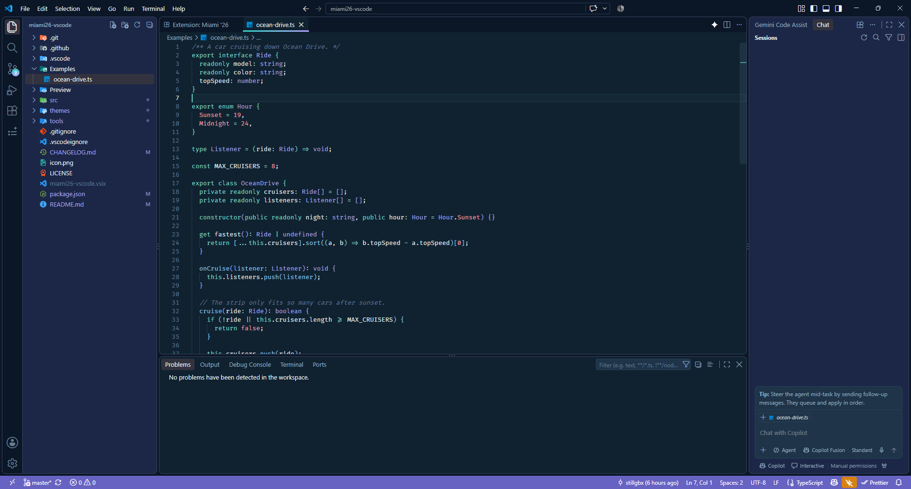
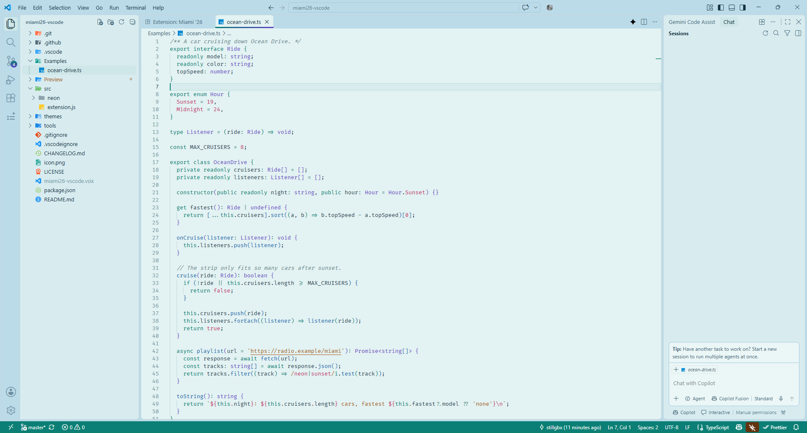
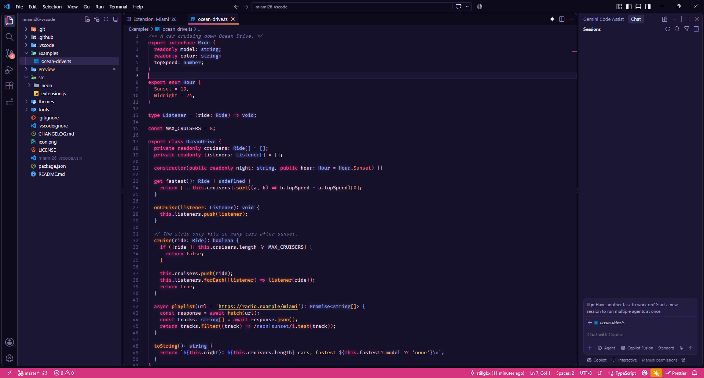
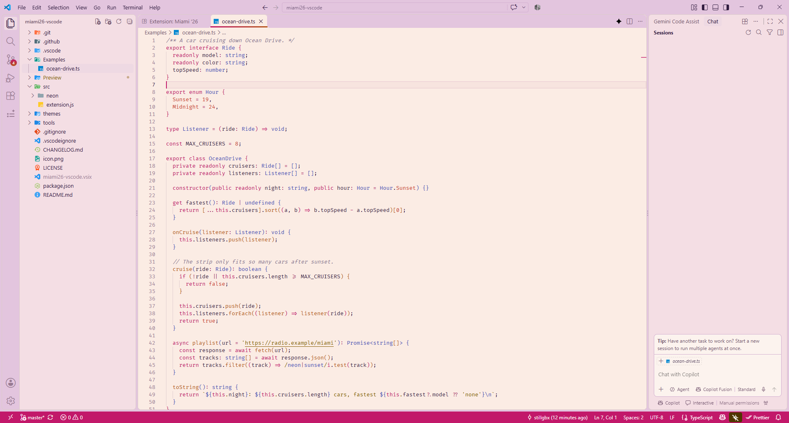

# Miami '26 - VS Code theme

[](https://github.com/stillgbx/miami26-vscode/actions/workflows/build.yml)
[](https://buymeacoffee.com/stillgbx)

Miami colors for VS Code. Two palettes, each in a dark and a light version:

* **Bay**: a day on the bay. Turquoise water, sky blue, lavender towers, pink facades and warm sand.
* **Sunset**: dusk on the ocean front. Magenta, sunset orange, gold and periwinkle buildings under a violet sky.

| | Dark | Light |
| --- | --- | --- |
| Bay | **Miami '26 Bay**, with optional neon glow | **Miami '26 Bay Light** |
| Sunset | **Miami '26 Sunset**, with optional neon glow | **Miami '26 Sunset Light** |

Also available for Visual Studio: [Miami '26 for Visual Studio](https://github.com/stillgbx/miami26-vs).

### Miami '26 Bay



### Miami '26 Bay Light



### Miami '26 Sunset



### Miami '26 Sunset Light



## Install

In VS Code, open the Extensions view, search for **Miami '26** and install it. Then pick a theme with *Preferences: Color Theme* (`Ctrl+K Ctrl+T`).

To install a release instead, download `miami26-vscode.vsix` from the [latest release](https://github.com/stillgbx/miami26-vscode/releases/latest) and run *Extensions: Install from VSIX...*.

## Neon glow

With the dark themes, the neon draws a glow around keywords, types, functions, tags and, faintly, variables, each in its own color. With all four themes, it also adds a gradient under the active tab and on the activity bar.

VS Code has no API for this kind of styling, so the neon works like the "Neon Dreams" of SynthWave '84: it adds a script to the VS Code installation files.

1. Run **Miami '26: Enable Neon** from the command palette, then reload VS Code.
2. Remove the "corrupt installation" warning, see below.

Good to know:

* **After each VS Code update**, run *Miami '26: Enable Neon* again: the update replaces the modified files.
* If VS Code is installed for all users (in *Program Files*), run it as administrator once to enable or disable the neon.
* The neon follows the theme: switch to another theme and it disappears, switch back and it returns.
* **Miami '26: Disable Neon** removes the script and restores the files.

Settings, applied the next time you run *Miami '26: Enable Neon*:

* `miami26.brightness`: brightness of the glow, from 0 to 1 (default 0.6).
* `miami26.disableGlow`: keep the tab and activity bar gradients without the glow around the text.

### Removing the "corrupt installation" warning

Since the neon modifies its files, VS Code then says that its installation is corrupt and shows `[Unsupported]` in the title bar. Nothing is broken: VS Code only notices that its files changed. To remove these warnings:

1. Install [Fix VSCode Checksums Next](https://marketplace.visualstudio.com/items?itemName=RimuruChan.vscode-fix-checksums-next).
2. Run **Fix Checksums: Apply** from the command palette.
3. Close and restart VS Code completely (a window reload is not enough).

Run *Fix Checksums: Apply* again each time the files change: after *Miami '26: Enable Neon* (including after a VS Code update) and after *Miami '26: Disable Neon*.

If you prefer not to install it, choose *Don't Show Again* on the warning.

## Recommended font

[Fira Code](https://github.com/tonsky/FiraCode), with ligatures:

```json
"editor.fontFamily": "'Fira Code', Consolas, monospace",
"editor.fontLigatures": true
```

## Credits

The neon is adapted from the "Neon Dreams" of [SynthWave '84](https://github.com/robb0wen/synthwave-vscode) by Robb Owen (MIT License).

Inspired by the colors of Miami. This is a fan-made theme, not affiliated with any game or studio.

## Development

Every color lives in `tools/generate-themes.js`, with the same palettes as the [Visual Studio themes](https://github.com/stillgbx/miami26-vs). Each palette gives:

* `ui`: the workbench colors (backgrounds, accent, status bar, selection...).
* `tokens`: the syntax colors, applied to TextMate scopes (`SCOPES`) and semantic tokens (`SEMANTIC`).
* `glow`, for the dark themes: the neon text-shadow around each glowing token color.

Then regenerate the themes and the neon table (`src/neon/themes.json`):

```
node tools/generate-themes.js
```

Press F5 to try the themes in an Extension Development Host, and open `Examples/ocean-drive.ts` there to see the token colors and the neon (it is also the file of the screenshots). The neon script itself is `src/neon/template.js`; `src/extension.js` fills it with the neon table and the settings, and adds it to the VS Code workbench.

### Releasing

1. Increase `version` in `package.json` and add the changes to `CHANGELOG.md`.
2. Push a tag with the same version, for example `v1.1.0`. The [Build](.github/workflows/build.yml) workflow packages the extension, attaches the VSIX to a new GitHub release, then publishes it on the [Visual Studio Marketplace](https://marketplace.visualstudio.com/items?itemName=stillgbx.miami26-vscode) and on [Open VSX](https://open-vsx.org/extension/stillgbx/miami26-vscode), the registry of Cursor, VSCodium and Windsurf.

The publications need, once:

* **Visual Studio Marketplace**: a *Trusted Publishing* policy on the `stillgbx` publisher ([manage page](https://marketplace.visualstudio.com/manage) > *Trusted Publishing* > *Create*), for the repository `stillgbx/miami26-vscode` and the workflow `build.yml`. No token or secret is needed.
* **Open VSX**: the `OVSX_PAT` repository secret (*Settings > Secrets and variables > Actions*), an Open VSX access token restricted to the `stillgbx` namespace. Without it, the workflow skips Open VSX with a warning.
